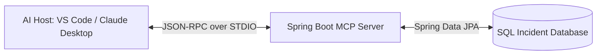

# DevOps AI Incident Responder (MCP Server)

An enterprise **Model Context Protocol (MCP)** server built with **Java 17, Spring Boot 3.4, and Spring AI** that connects AI agents (Claude Desktop, VS Code Copilot, Cursor) to microservice health telemetry and a persistent SQL incident database.

## Architecture



## Core MCP Tools Implemented
* **`checkServiceHealth`** — Evaluates microservice status (`HEALTHY` vs `DEGRADED`), resource metrics, and retrieves active `OPEN` incidents.
* **`reportIncident`** — Persists new production incident records (`LOW`, `MEDIUM`, `HIGH`, `CRITICAL`) into the database.
* **`resolveIncident`** — Updates incident status to `RESOLVED` by incident ID during automated triage.

## Tech Stack
* **Backend:** Java 17, Spring Boot 3.4, Spring AI MCP Server (`1.0.0`)
* **Database:** Spring Data JPA, Embedded H2 SQL (PostgreSQL-compatible schema)
* **DevOps & CI/CD:** Multi-stage Docker build, GitHub Actions automated build pipeline

## Quick Start

### 1. Build the Server
```bash
mvn clean package
```

### 2. Connect to VS Code (`.vscode/mcp.json`)
```json
{
  "servers": {
    "azure-devops": {
      "type": "stdio",
      "command": "java",
      "args": [
        "-jar",
        "/path/to/azure-devops-mcp-server/target/azure-devops-mcp-server-0.0.1-SNAPSHOT.jar"
      ]
    }
  }
}
```
